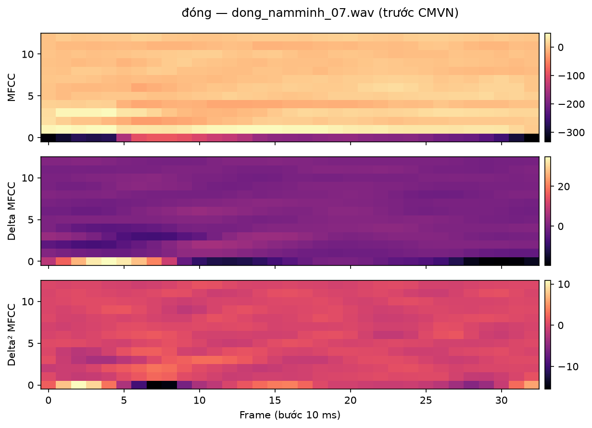
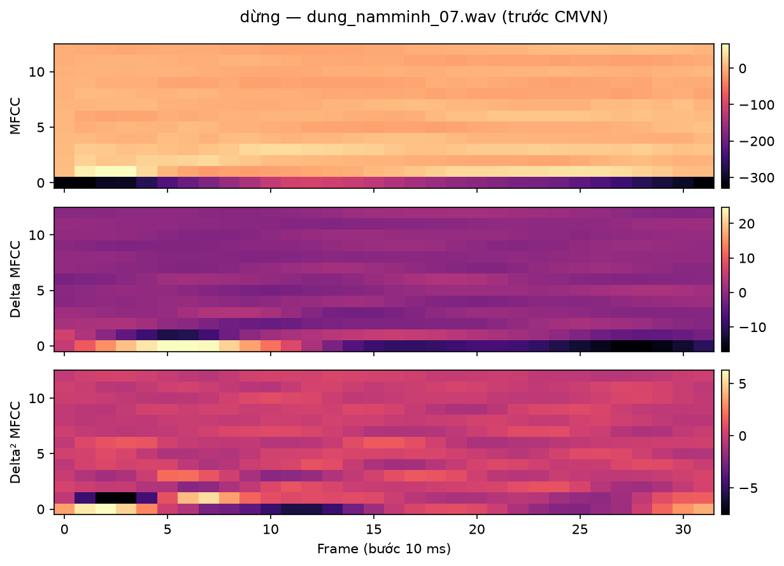
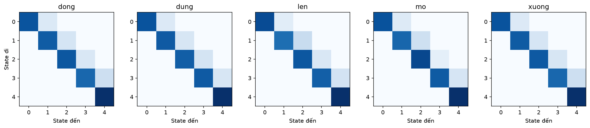
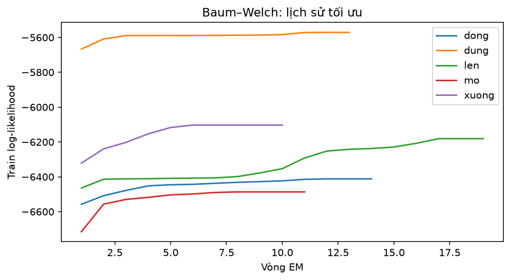
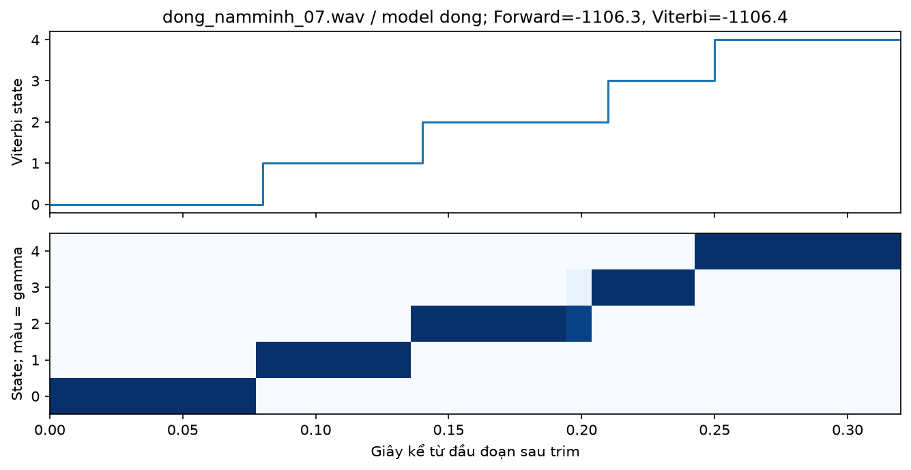
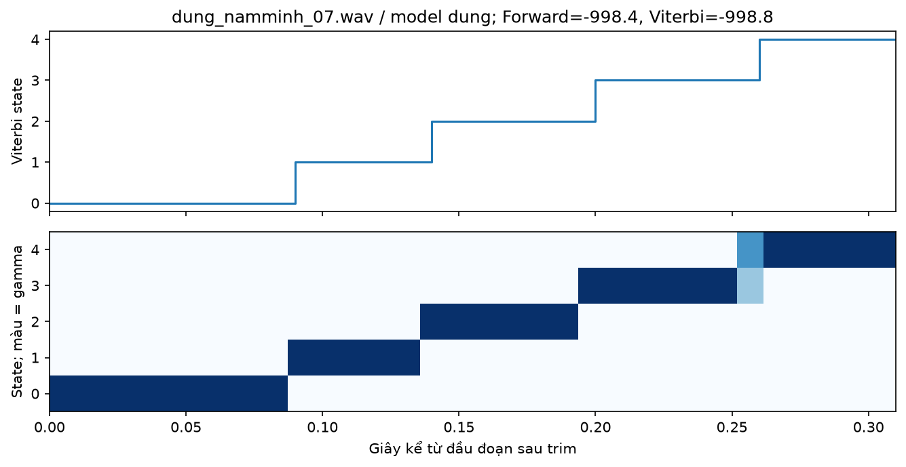
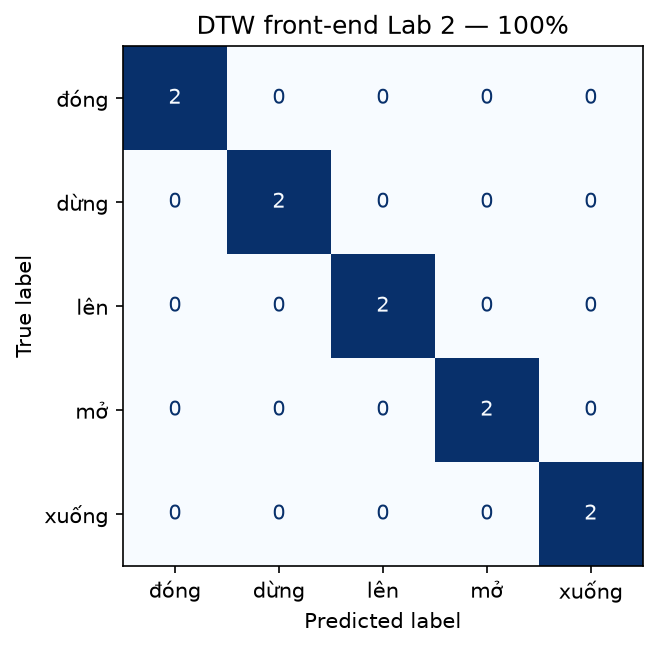
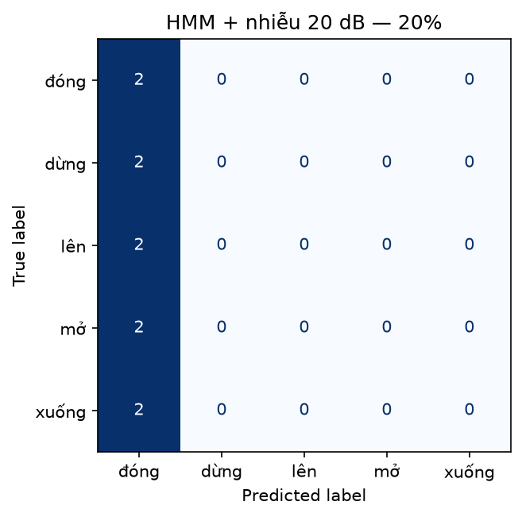
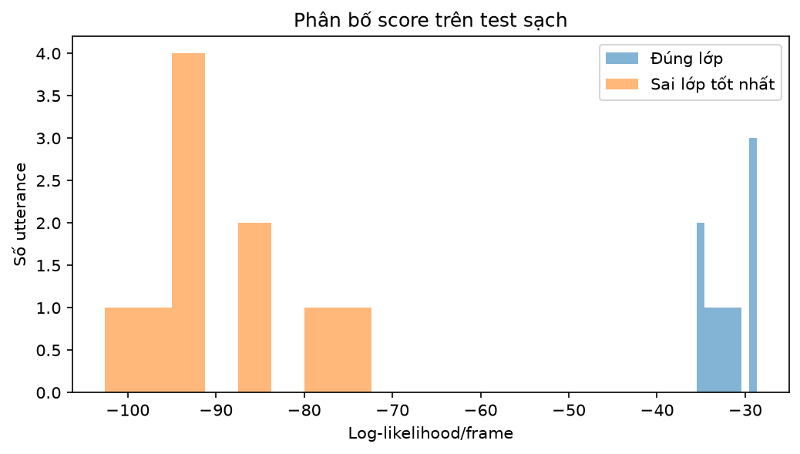

# LAB 3 — NHẬN DẠNG TIẾNG NÓI NÂNG CAO VỚI HMM

**Sinh viên:** Lỗ Anh Việt  
**MSSV:** 2351260695  
**Học phần:** CSE457 — Xử lý âm thanh và tiếng nói

## 1. Mục tiêu và thiết kế thực nghiệm

Xây dựng hệ nhận dạng từ/lệnh tách rời bằng một Gaussian HMM cho mỗi từ; quan sát likelihood và Viterbi alignment; so sánh với MFCC + DTW; thử số state, đặc trưng động, nhiễu và language-model re-ranking. Các hình và bảng dưới đây được sinh từ lần chạy notebook trên dữ liệu đã chỉ định.

Các từ sử dụng: **đóng, dừng, lên, mở, xuống**. Baseline được định trước: 5 state, Gaussian diagonal và đặc trưng 39 chiều. Không chọn cấu hình cuối theo test accuracy; các ablation là so sánh mô tả trên cùng split.

**Nguồn dữ liệu: tiếng nói tổng hợp TTS, không phải ghi âm người thật.** Giọng: `vi-VN-NamMinhNeural`. Mỗi utterance có yêu cầu TTS riêng với rate/pitch định trước. Train/test dùng cùng engine và giọng, nên thí nghiệm chưa đo khả năng khái quát sang người nói thực; kết quả sạch cao có thể phản ánh tính đồng nhất của TTS.

| Nhãn | Từ | Train | Test |
| --- | --- | --- | --- |
| dong | đóng | 6 | 2 |
| dung | dừng | 6 | 2 |
| len | lên | 6 | 2 |
| mo | mở | 6 | 2 |
| xuong | xuống | 6 | 2 |

Tổng cộng **30 train + 10 test**. WAV mono, 16 kHz, PCM 16-bit; bộ tổng hợp có 0,2–0,5 giây khoảng lặng ở đầu/cuối. `dataset/manifest.json` ghi nguồn, split, setting và SHA-256. `dataset/format_audit.csv` kiểm tra silence thực tế và định dạng. Pipeline kiểm tra trùng đường dẫn, hash file và hash mẫu âm thanh đã giải mã giữa train/test; không dùng test trong fit, khởi tạo Gaussian hay calibration reject.

| Thành phần | Cấu hình |
| --- | --- |
| Front-end | Trim 30 dB; pre-emphasis 0,97; Hamming 25 ms; hop 10 ms; FFT 512; 26 Mel |
| Đặc trưng | 13 MFCC + 13 Δ + 13 Δ²; CMVN theo từng utterance |
| HMM | 5 state/từ; diagonal covariance; tối đa 80 vòng; tol=0.001 |
| Tái lập | Seed 695; manifest SHA-256; requirements-lock.txt; environment.json |
| Sản phẩm | Lab03_2351260695.ipynb; report_Lab03.md; figures/; models/; CSV/JSON ở thư mục gốc |

## 2. Đặc trưng MFCC động — phần A

Pipeline: WAV → mono/16 kHz → cắt silence → tiền nhấn → MFCC → Δ/Δ² → CMVN. Vector mỗi frame có 39 chiều; giữ độ dài T khác nhau giữa các utterance. Delta dùng hồi quy lân cận, delta-delta dùng đạo hàm bậc hai. File không có tiếng hoặc quá ngắn được báo lỗi. CMVN chỉ dùng thống kê của chính utterance đang biến đổi; không học thống kê chung từ test.

*Hình 1. MFCC, delta và delta-delta của từ thứ nhất, trước CMVN.*

*Hình 2. MFCC, delta và delta-delta của từ thứ hai, trước CMVN.*

MFCC thể hiện hình dạng phổ theo thời gian; Δ làm rõ xu hướng thay đổi và Δ² làm rõ thay đổi của xu hướng. Những dải phổ, onset/offset và số frame khác nhau cho thấy hai từ có tiến trình âm học khác nhau. HMM đã mô hình hóa chuỗi state nhưng vẫn giả định output độc lập khi biết state; đặc trưng động bổ sung biến thiên cục bộ. Chưa có nhãn phoneme nên không gán tên âm vị chỉ dựa vào màu heatmap.

## 3. Cấu hình HMM và huấn luyện — phần B, C

HMM λ = (A, B, π): A là xác suất chuyển trạng thái, B là mật độ Gaussian phát xạ, π là phân bố bắt đầu. Giả thiết Markov bậc một: state hiện tại chỉ phụ thuộc state trước; quan sát phụ thuộc state hiện tại. Đặt π = [1,0,…,0], chỉ cho self-loop và next-state; aᵢᵢ=0,7, aᵢ,ᵢ₊₁=0,3 ban đầu, state cuối tự lặp với xác suất 1.

Khởi tạo mean/covariance từ các phần thời gian liên tiếp của train utterance để emissions có thứ tự ban đầu. Mỗi lớp ghép các ma trận train thành `X_concat`, truyền `lengths` để thư viện không tạo chuyển trạng thái giữa hai bản ghi. `init_params=''` giữ tham số đã khởi tạo, `params='tmc'` cập nhật transition/mean/covariance và giữ π. Sau fit, kiểm tra tổng hàng A bằng 1 và mọi transition ngược/skip bằng 0.

Với D=39, diagonal covariance cần 39 phương sai/state; full covariance cần 39×40/2=780 tham số độc lập/state. Diagonal giảm số tham số, thích hợp với dữ liệu ít. Full covariance chỉ được thử khi mỗi lớp đạt ít nhất 2×D×n_states frame; đây là tiêu chí thận trọng của triển khai, không phải điều kiện đảm bảo đủ dữ liệu.

*Hình 3. Transition matrix sau huấn luyện của năm model.*

| Model | Train frames | Vòng EM | Dừng vì | Gain cuối |
| --- | --- | --- | --- | --- |
| dong | 191 | 14 | tolerance | 0.00013345 |
| dung | 185 | 13 | tolerance | 2.0141e-06 |
| len | 196 | 19 | tolerance | 0.00072746 |
| mo | 220 | 11 | likelihood_decreased | -3.3617e-05 |
| xuong | 194 | 10 | tolerance | 0.00081759 |

*Hình 4. Train log-likelihood theo vòng Baum–Welch.*

Baum–Welch là EM: E-step tính kỳ vọng state/transition bằng Forward–Backward, M-step cập nhật tham số theo trọng số trách nhiệm. EM chỉ đảm bảo nghiệm cục bộ, phụ thuộc khởi tạo, số state, covariance, lượng dữ liệu và môi trường. Cờ `monitor.converged=True` có thể xuất hiện khi hết số vòng; vì vậy báo cáo riêng `tolerance`, `max_iter`, `likelihood_decreased` và gain cuối trong `training_diagnostics.json`.

## 4. Likelihood và Viterbi — phần D

Forward cộng xác suất của mọi đường hợp lệ để tính P(X|λ), còn Viterbi thay tổng bằng max để tìm đường trạng thái tốt nhất. Mã thực hiện trong miền log bằng logsumexp. Forward–Backward minh họa được đối chiếu với `model.score`; log-likelihood Forward ≥ log-probability Viterbi. γₜ(i) là posterior trách nhiệm state i cho frame t; ξₜ(i,j) là posterior trách nhiệm chuyển i→j tại t. Thư viện thực hiện huấn luyện EM đầy đủ.

| Test utterance | Dự đoán | dong | dung | len | mo | xuong | Margin/frame |
| --- | --- | --- | --- | --- | --- | --- | --- |
| dong_namminh_07.wav | dong | -1106.3 | -4249.9 | -3645.2 | -3703.4 | -3385.2 | 69.06 |
| dung_namminh_07.wav | dung | -2965.9 | -998.4 | -2743.7 | -4085.3 | -3545.5 | 54.54 |
| len_namminh_07.wav | len | -3151.2 | -3215.9 | -1206.1 | -3890.5 | -4272.8 | 57.21 |

Bảng gồm ba test utterance khác lớp, chấm bằng toàn bộ năm model. Chọn log-likelihood lớn nhất; score âm hơn nghĩa là thấp hơn. Chia các score cho cùng T không đổi argmax trên một utterance. Score/frame hữu ích để quan sát phân bố giữa các file khác độ dài và thiết kế reject.

*Hình 5. Viterbi path và posterior gamma của utterance thứ nhất.*

*Hình 6. Viterbi path và posterior gamma của utterance thứ hai.*

| Utterance | State | Frame | Occupancy xấp xỉ (ms) |
| --- | --- | --- | --- |
| dong_namminh_07.wav | 0 | 8 | 80 |
| dong_namminh_07.wav | 1 | 6 | 60 |
| dong_namminh_07.wav | 2 | 7 | 70 |
| dong_namminh_07.wav | 3 | 4 | 40 |
| dong_namminh_07.wav | 4 | 8 | 80 |
| dung_namminh_07.wav | 0 | 9 | 90 |
| dung_namminh_07.wav | 1 | 5 | 50 |
| dung_namminh_07.wav | 2 | 6 | 60 |
| dung_namminh_07.wav | 3 | 6 | 60 |
| dung_namminh_07.wav | 4 | 6 | 60 |

Path không giảm và chỉ tăng tối đa một state/frame. Self-loop kéo dài occupancy khi nói chậm; số frame × 10 ms là ước lượng thời lượng, không phải biên phoneme chính xác do các cửa sổ chồng lấn. Model không bắt buộc mọi utterance kết thúc ở state cuối: likelihood kết thúc bằng tổng qua mọi state, đúng công thức đề. DTW warping path ánh xạ frame test sang frame template; Viterbi ánh xạ frame vào state của model.

## 5. Đánh giá sạch và DTW baseline — phần E

HMM train accuracy **100%**, test accuracy **100%** trên 10 file. Mỗi lỗi tương ứng 10 điểm phần trăm, nên tập test còn nhỏ. Accuracy sạch cao trên cùng TTS voice chưa chứng minh nhận dạng tốt tiếng nói thực.

*Hình 7. Confusion matrix HMM trên test sạch.*

*Hình 8. Confusion matrix DTW dùng front-end Lab 2 trên cùng test.*

| Phương pháp | Test accuracy | Fit model (s) | Decode (ms/file) |
| --- | --- | --- | --- |
| HMM_39D | 100% | 0.064892 | 0.495 |
| DTW_shared_39D | 100% | 0.000007 | 0.509 |
| DTW_Lab2_13D | 100% | 0.000012 | 2.363 |

DTW Lab 2 giữ endpoint adaptive, 24 Mel, 13 MFCC và CMN cũ; DTW_shared dùng cùng front-end 39-D/CMVN như HMM. Mỗi test được so với mọi train template rồi lấy min distance, chuẩn hóa tổng chi phí theo độ dài path. Recurrence và quy tắc tie được đối chiếu với mã Lab 2. Decode timing loại trừ front-end và JIT lần đầu; thời gian fit DTW chỉ gồm tạo danh sách template. Các thời gian là một lần đo trên máy hiện tại.

Trên test sạch, chưa có mẫu khác nhau về đúng/sai giữa HMM và DTW Lab 2. Không thể kết luận ưu thế từ accuracy đang bão hòa; phần mismatch bên dưới cung cấp trường hợp khác biệt trên cùng front-end.

## 6. Thí nghiệm tham số và độ bền — E1–E5, phần H

| Thí nghiệm | State | Chiều | Train | Test | Model hết vòng | Trạng thái |
| --- | --- | --- | --- | --- | --- | --- |
| E1_states3 | 3 | 39 | 100% | 100% | 0 | ok |
| baseline_states5_39D | 5 | 39 | 100% | 100% | 0 | ok |
| E1_states7 | 7 | 39 | 100% | 100% | 1 | ok |
| E2_mfcc13 | 5 | 13 | 100% | 100% | 0 | ok |
| E3_full | 5 | 39 | — | — | — | skipped: quá ít frame/state so với D=39; E3 chỉ yêu cầu nếu đủ dữ liệu |

39-D so với 13-D thay đổi test accuracy **+0 điểm phần trăm**. Khi cả hai cùng đạt trần trên dữ liệu TTS nhỏ, chưa có bằng chứng định lượng rằng delta giúp phân biệt một lớp cụ thể. Với số state cũng cần xem diagnostics: cùng accuracy không có nghĩa cùng chất lượng hội tụ. Không gán underfit/overfit chỉ dựa vào số state hoặc một accuracy sạch.

| Train/lớp | HMM 39-D | DTW cùng 39-D |
| --- | --- | --- |
| 1 | 100% | 100% |
| 2 | 100% | 100% |
| 6 | 100% | 100% |

Các tập train nhỏ lấy prefix cố định từ train ban đầu, giữ nguyên test. Đây là kiểm tra nhạy với lượng mẫu trên một nguồn TTS đồng nhất; chưa đại diện quan hệ dữ liệu–accuracy của bản ghi nhiều người nói.

| Phương pháp | Sạch | Nhiễu 20 dB |
| --- | --- | --- |
| HMM_39D | 100% | 20% |
| DTW_shared_39D | 100% | 60% |
| DTW_Lab2_13D | 100% | 20% |

Nhiễu Gaussian được thêm trước trích đặc trưng, SNR 20 dB tính theo công suất vùng tiếng nói sau trim, seed cố định. HMM giảm từ **100%** xuống **20%**, giảm **80 điểm phần trăm**. Không dùng noisy test trong fit hoặc chọn baseline.

*Hình 9. Confusion matrix HMM khi thêm nhiễu.*

Phân tích front-end: trung vị đoạn được giữ sau trim là **0.31s sạch** và **1.40s nhiễu**; noise làm phép trim tương đối giữ thêm vùng nền. Có **6/10** noisy utterance chỉ đi qua một state của model được chọn. Phân bố dự đoán nhiễu: {'dong': 10}. Các dấu hiệu này cho thấy mismatch ở cả endpoint/đặc trưng và mô hình duration; chưa cô lập được riêng nguyên nhân nào quyết định toàn bộ lỗi.

| Mẫu nhiễu | Nhãn thật | HMM 39-D | DTW cùng 39-D |
| --- | --- | --- | --- |
| mo_namminh_07.wav | mo | dong | mo |
| mo_namminh_08.wav | mo | dong | mo |
| xuong_namminh_07.wav | xuong | dong | xuong |

Đây là các trường hợp hai phương pháp khác nhau về đúng/sai với cùng front-end, cùng noise realization và split. DTW không chịu phân bố Gaussian của state đã học nên có thể phản ứng khác với mismatch; quan sát này không chứng minh DTW luôn bền nhiễu hơn HMM.

*Hình 10. Phân bố score/frame của đúng lớp và sai lớp tốt nhất trên test sạch.*

Argmax vẫn chọn một lớp khi gặp unknown. Đề xuất reject nếu best score/frame thấp hoặc margin top-1/top-2 nhỏ. Holdout lấy một file train/lớp, còn lại dùng fit; có 5 mẫu calibration đúng. Ngưỡng gợi ý score=-33.84282581492621, margin=43.46749303204646. Chưa áp dụng ngưỡng vào baseline: calibration nhỏ, chưa có unknown thật, final model được fit lại có thể đổi score distribution. Một mẫu sai vẫn có margin lớn, nên margin đơn lẻ không đảm bảo độ tin cậy.

## 7. Lexicon, bigram và MAP re-ranking — phần F, G, E6

Whole-word HMM ánh xạ trực tiếp từ → model nên không cần pronunciation lexicon để nhận dạng. Khi chuyển sang phone/subword HMM, lexicon chỉ định chuỗi phone model cần nối để tạo word HMM. Parser `parse_lexicon` đọc `WORD PHONE_1 ... PHONE_K`, bỏ chú thích và báo lỗi từ trùng/thiếu phone; đã có kiểm thử bằng inventory giả.

**Lexicon chưa có phiên âm chuẩn** vì chưa nhận phone inventory của giảng viên. Các từ còn thiếu: dong, dung, len, mo, xuong. Không coi ký hiệu tự đặt là phiên âm tiếng Việt được xác nhận.

`corpus.txt` là corpus minh họa tự tạo cho năm lệnh, không lấy nhãn test để đếm. Đếm unigram và bigram; add-k=0,5: P(w|prev) = [C(prev,w)+k]/[C_out(prev)+kV]. C_out chỉ đếm context có từ kế tiếp trong vocabulary; mỗi dòng có context bắt đầu `<s>`, không gộp sang câu khác. Tổng xác suất mọi ứng viên bằng 1.

| Previous | Current | Bigram count | Context count | P(current\|previous) |
| --- | --- | --- | --- | --- |
| &lt;s&gt; | dong | 2 | 10 | 0.2000 |
| &lt;s&gt; | len | 1 | 10 | 0.1200 |
| &lt;s&gt; | mo | 6 | 10 | 0.5200 |
| &lt;s&gt; | xuong | 1 | 10 | 0.1200 |
| dong | mo | 2 | 2 | 0.5556 |
| dung | dong | 5 | 7 | 0.5789 |
| dung | len | 1 | 7 | 0.1579 |
| dung | xuong | 1 | 7 | 0.1579 |

Re-ranking: Score(w)=log P(X|w)/T + λ log P(w|prev), thử λ=0; 0,1; 0,3; 1. Chọn ba utterance có acoustic margin nhỏ nhất và liệt kê mọi previous-word context, không suy context từ nhãn đúng. Context là giả định, nên không gộp thành accuracy nhận dạng chuỗi có context thật.

Có **0/72** tình huống giả định đổi acoustic argmax trong dải λ đang thử. Acoustic margin nhỏ nhất trên test là **39.91/frame**; “nhỏ nhất” không đồng nghĩa hai ứng viên thực sự gần nhau.

| File | Prev giả định | λ | Acoustic | Kết hợp |
| --- | --- | --- | --- | --- |
| xuong_namminh_08.wav | &lt;s&gt; | 0 | xuong | xuong |
| xuong_namminh_08.wav | &lt;s&gt; | 0.1 | xuong | xuong |
| xuong_namminh_08.wav | &lt;s&gt; | 0.3 | xuong | xuong |
| xuong_namminh_08.wav | &lt;s&gt; | 1.0 | xuong | xuong |

Trong thí nghiệm này LM chưa làm đổi quyết định, nên không quan sát được ví dụ sửa lỗi hoặc làm sai trong dải λ≤1. Về nguyên lý, λ lớn có thể lấn át âm học nếu prior ưu tiên một ứng viên khác. Cần dữ liệu âm học khó hơn và context thật để đánh giá lợi ích; không tạo ví dụ giả để tuyên bố LM cải thiện.

## 8. Trả lời câu hỏi lý thuyết

### Câu 1. Forward và Viterbi khác nhau ở phép toán nào và trả lời hai câu hỏi khác nhau ra sao?

Forward dùng phép **cộng** xác suất từ các đường trước đó để tính likelihood P(X|λ), tức khả năng model sinh ra toàn bộ chuỗi quan sát khi xét mọi state path hợp lệ. Viterbi thay phép cộng bằng **max** và lưu back-pointer để tìm một state path có xác suất lớn nhất. Vì vậy, Forward trả lời “model này giải thích utterance tốt đến mức nào?”, còn Viterbi trả lời “chuỗi trạng thái nào giải thích utterance tốt nhất?”. Trong lab, `model.score(F)` dùng cho chọn từ; `decode(..., algorithm='viterbi')` dùng để xem alignment. Log-likelihood Forward không nhỏ hơn log-probability của riêng đường Viterbi.

### Câu 2. Giải thích γₜ(i) và ξₜ(i,j) bằng ngôn ngữ trách nhiệm trong EM.

**γₜ(i)=P(qₜ=i|X,λ)** là mức trách nhiệm của state i đối với frame t sau khi đã xét cả utterance. Ví dụ γₜ(i)=0,8 nghĩa là state i nhận trọng số 0,8 cho frame đó, không phải một nhãn cứng bắt buộc. **ξₜ(i,j)=P(qₜ=i,qₜ₊₁=j|X,λ)** là trách nhiệm của chuyển i→j giữa hai frame liên tiếp. Trong M-step, γ làm trọng số để cập nhật mean/covariance, còn tổng ξ cho số lần chuyển kỳ vọng để cập nhật A. Tổng γ qua các state ở mỗi frame bằng 1; tổng ξ qua mọi cặp state ở một bước chuyển cũng bằng 1.

### Câu 3. Tại sao Baum–Welch có thể hội tụ đến nghiệm xấu? Nêu ít nhất ba nguyên nhân thực nghiệm.

Baum–Welch là EM và tối ưu likelihood theo khởi tạo hiện tại, nên có thể dừng ở **cực đại cục bộ**, không đảm bảo nghiệm tốt nhất toàn cục. Ba nguyên nhân thường gặp là: **khởi tạo Gaussian không phù hợp**, **quá ít dữ liệu so với số tham số**, và **chọn quá nhiều state hoặc covariance quá phức tạp**. Covariance quá nhỏ cũng có thể gây bất ổn số; giới hạn vòng lặp có thể làm mô hình dừng trước khi cải thiện đủ. Cần xem lịch sử likelihood, gain cuối và lý do dừng, thay vì chỉ nhìn cờ `converged`. Ngoài ra, hội tụ tốt trên train không đảm bảo test tốt khi giọng nói hoặc môi trường bị mismatch.

### Câu 4. Tại sao diagonal covariance thường được ưu tiên khi dữ liệu nhỏ và feature dimension cao?

Diagonal covariance chỉ ước lượng phương sai của từng chiều, còn full covariance phải ước lượng thêm tương quan giữa mọi cặp chiều. Với vector 39-D, diagonal có **39** tham số covariance/state, trong khi full có **780** tham số độc lập/state, chưa tính mean. Ít mẫu sẽ làm nhiều ước lượng tương quan của full covariance thiếu ổn định và dễ quá khớp. Diagonal giảm số tham số và chi phí tính toán, nên phù hợp hơn với bộ train nhỏ của lab. Đổi lại, nó bỏ qua tương quan giữa các chiều; đây là lựa chọn đánh đổi, không có nghĩa các MFCC thực sự độc lập.

### Câu 5. Vì sao delta features hữu ích dù HMM đã mô hình hóa chuỗi theo thời gian?

HMM mô hình hóa thứ tự và thời lượng ngầm thông qua **chuyển trạng thái**, nhưng Gaussian chuẩn của một state chỉ nhìn vector tại frame hiện tại. Nó không trực tiếp mô tả đầy đủ cách MFCC của các frame lân cận cùng biến đổi. Δ đưa xu hướng biến thiên phổ vào vector hiện tại; Δ² đưa thêm thông tin thay đổi của xu hướng, nên có thể giúp phân biệt các chuyển tiếp âm học. Tuy nhiên, số chiều tăng cũng cần đủ dữ liệu. Lợi ích phải được kiểm tra bằng thí nghiệm 13-D so với 39-D trên cùng split, không thể khẳng định delta luôn cải thiện accuracy.

### Câu 6. Whole-word HMM không cần lexicon trong trường hợp nào? Khi nào lexicon trở thành bắt buộc?

Khi mỗi từ trong bộ từ vựng đã có **một whole-word HMM riêng**, hệ thống có thể chấm trực tiếp utterance bằng model của từng từ rồi chọn score lớn nhất; không cần biết từ được ghép từ những phone nào. Khi chuyển sang phone/subword HMM và dùng các đơn vị đó để tạo từ, cần một ánh xạ **từ → chuỗi đơn vị phát âm**, thường nằm trong lexicon. Decoder sẽ nối các phone HMM theo chuỗi này để tạo đường đi cho từ. Phone symbols phải khớp inventory của hệ thống; vì chưa có inventory giảng viên, bài chỉ hoàn thành parser và giữ phần phiên âm ở trạng thái chờ.

### Câu 7. Nếu test utterance dài hơn do nói chậm, self-loop của HMM giúp gì?

Self-loop cho phép một state phát ra **nhiều frame liên tiếp** trước khi chuyển sang state kế tiếp. Khi nói chậm, một giai đoạn âm học kéo dài có thể được biểu diễn bằng cách ở lại state đó lâu hơn, thay vì cần số frame test bằng train. Viterbi tìm path có thời gian lưu ở các state phù hợp nhất với quan sát và xác suất chuyển đã học. Ví dụ cùng một đoạn có thể chiếm 5 frame khi nói nhanh và 9 frame khi nói chậm. Nếu tốc độ hoặc cách phát âm lệch quá xa train thì Gaussian và transition vẫn có thể không phù hợp; self-loop không bảo đảm xử lý mọi mức nói chậm.

### Câu 8. Với cùng một utterance, có cần chia log-likelihood cho T để chọn model tốt nhất không? Tại sao?

**Không cần**, vì tất cả model đang chấm cùng ma trận đặc trưng có cùng số frame T>0. Chia mọi score cho cùng một hằng số dương giữ nguyên thứ tự, nên argmax log P(X|λw) và argmax [log P(X|λw)/T] cho cùng nhãn. Chuẩn hóa theo frame hữu ích khi xem thống kê giữa các utterance khác độ dài hoặc thiết kế ngưỡng reject. Trong re-ranking có LM, việc chia acoustic score cho T làm thay đổi tương quan thang điểm với prior, nên phải dùng λ phù hợp với đúng quy ước score đã chọn.

### Câu 9. So sánh warping path của DTW với state path của Viterbi.

Warping path của DTW nối **frame của utterance test với frame của một template**, cho phép một frame ứng với nhiều frame bên kia để bù khác biệt tốc độ. Mục tiêu là tìm đường có tổng chi phí đối sánh nhỏ nhất; triển khai của bài chuẩn hóa chi phí đó theo độ dài path. Viterbi path gán **mỗi frame vào một state ẩn của HMM đã học**, tối đa hóa xác suất kết hợp của emissions và transitions. Cả hai đều dùng quy hoạch động để tránh liệt kê mọi đường. DTW phụ thuộc các template lưu sẵn, còn Viterbi dùng tham số xác suất học từ nhiều utterance; state HMM không tự động đồng nghĩa với một phoneme.

### Câu 10. Vì sao argmax vẫn chọn một lớp với từ ngoài vocabulary? Đề xuất reject criterion.

Argmax chỉ tìm model có score lớn nhất trong các lớp đã biết, nên luôn chọn một lớp ngay cả khi **mọi model đều giải thích input kém**. Có thể thêm nhãn unknown khi best log-likelihood/frame thấp hơn ngưỡng τ, hoặc khi margin top-1/top-2 thấp hơn ngưỡng m. Các ngưỡng cần được chọn trên validation độc lập gồm cả từ trong vocabulary và unknown; không chỉnh ngưỡng bằng test. Trong bài, ngưỡng hiện tại chỉ là gợi ý từ holdout train và chưa được xác nhận bằng unknown thật. Kết quả nhiễu còn cho thấy một mẫu sai vẫn có margin lớn, vì vậy không nên dùng riêng margin như một bảo đảm độ tin cậy.

## 9. Kết luận và giới hạn

Pipeline huấn luyện và giải mã chạy lại được, có kiểm tra topology, likelihood, Viterbi và DTW baseline. Trên bộ hiện tại HMM sạch đạt 100%, nhiễu 20 dB đạt 20%. Các ablation cần được đọc cùng diagnostics và giới hạn dữ liệu; kết quả sạch không thay thế đánh giá robustness.

Dữ liệu tổng hợp có cùng nguồn giọng ở hai split, test chỉ 10 file, chưa có nhiều người nói/unknown/context chuỗi thật. Cần thêm ghi âm thực và inventory/corpus giảng viên. Hướng cải thiện có thể kiểm chứng tiếp: endpoint dựa nền nhiễu, silence model hoặc train đa điều kiện, chọn/hiệu chỉnh trên validation trước khi đánh giá test mới.

## 10. Tài liệu và file đối chiếu

- Đề `Lab 3.pdf`, mục 4–7, case study và câu hỏi phân tích.
- [hmmlearn 0.3.3 API](https://hmmlearn.readthedocs.io/en/stable/api.html).
- [librosa feature.delta](https://librosa.org/doc/latest/generated/librosa.feature.delta.html).
- [edge-tts](https://github.com/rany2/edge-tts): công cụ tạo WAV tổng hợp qua TTS.
- Rabiner & Schafer, *Theory and Applications of Digital Speech Processing*.
- Mã MFCC/DTW Lab 2 của cùng sinh viên: `lab2_baseline.py`.

Bảng nguồn: `dataset_audit.csv`, `split.json`, `experiments.csv`, `training_diagnostics.json`, `likelihood_examples.csv`, `dtw_vs_hmm.csv`, `noise_methods.csv`, `noise_frontend_analysis.csv`, `lm_reranking.csv`. Notebook chính: `Lab03_2351260695.ipynb`; model: `models/hmm_baseline.joblib`.
